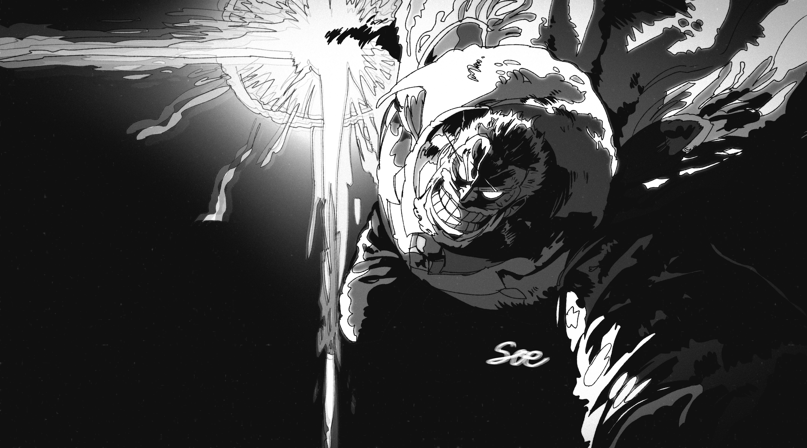

<!DOCTYPE html>
<html lang="ja">
<head>
<meta charset="UTF-8">
<meta name="viewport" content="width=device-width, initial-scale=1.0">
<meta name="description" content="SOE — Film, Music and Art. Creating beyond boundaries.">
<title>SOE. — Creative Portfolio</title>

</head>
<body>
<header class="header">
  <a href="#" class="logo">SOE.</a>
  <nav>
    <a href="#works">WORKS</a>
    <a href="#about">ABOUT</a>
    <a href="#contact">CONTACT</a>
  </nav>
</header>

<main>
<section class="hero">
  
FILM / MUSIC / ART

  <h1>I CREATE WORLDS.</h1>
  
Creating beyond boundaries. 映像・音楽・美術を通して、自分だけの世界を創る。

  <a href="#works" class="explore">EXPLORE WORKS ↘</a>
  
INDEPENDENT CREATIVE — SOE

</section>

<section id="works" class="section">
  
01 — SELECTED WORKS

  <h2>WORKS.</h2>
  

    <article class="work">
      
COMING SOON

      <h3>FILM & VIDEO</h3>
      
Short Films / Music Videos / Visuals

    </article>
    <article class="work">
      
COMING SOON

      <h3>MUSIC</h3>
      
Original Music / Vocal / Composition

    </article>
    <article class="work">
      

        
      

      <h3>ART & DESIGN</h3>
      
Illustration / Fan Art

    </article>
  

</section>

<section id="about" class="section about">
  
02 — ABOUT

  <h2>Beyond Imagination.</h2>
  
I create through film, music and art. My goal is to express ideas, emotions and worlds that cannot be described in words.

  
表現の可能性を広げ、自分にしか創れない作品を生み出す。 その過程を世界に発信していく。

</section>

<section id="contact" class="section contact">
  
03 — CONTACT

  <h2>LET'S CONNECT.</h2>
  
Follow my creative journey.

  <a href="https://www.instagram.com/st._creative/" target="_blank" rel="noopener noreferrer">INSTAGRAM ↗</a>
</section>
</main>

<footer>
  <a href="#" class="logo">SOE.</a>
  
© 2026 SOE CREATIVE. ALL RIGHTS RESERVED.

</footer>
</body>
</html>
